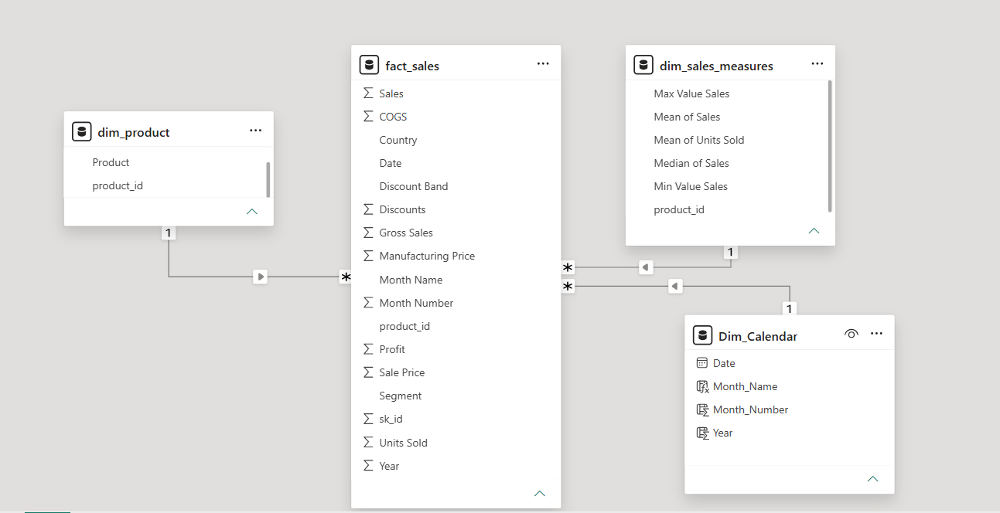

# Building a Star Schema in Power BI | DIO Challenge

### From one Excel table to a relational data model

This project is part of my **DIO Power BI Bootcamp**, and this time I wanted to challenge myself to complete the modelling process independently.

The task was to transform Microsoft's Financial Sample dataset, originally stored in a single Excel table, into a star schema using Power Query, Power BI and DAX.

Although DIO provided a suggested structure, we were encouraged to make our own decisions, provided we could explain our reasoning.

And that's exactly what I decided to do! 😊

## ⭐ My Star Schema

<p align="center">
  
</p>

*My final Power BI model, with `fact_sales` at the centre and three connected tables.*

## Starting with the original data

I imported the Financial Sample Excel file into Power BI and opened Power Query to inspect the data.

Before creating any tables, I:

- Kept the original dataset as `Financials Original` for reference.
- Checked the data types and changed monetary columns to Fixed Decimal Number.
- Reviewed the data for duplicates, inconsistencies and unexpected values.
- Considered which columns described products and which belonged to individual sales records.

I wanted to understand the data before deciding how to split it.

## Creating `dim_product`

I duplicated the original query and started building my product dimension.

My initial idea was to keep the product name and manufacturing price, with one row per product.

But before removing duplicates, I wanted to make sure each product really did have a consistent manufacturing price.

I tried using Power Query's Conditional Column feature, but it wasn't displaying the columns I needed.

So I found another way!

I created a Custom Column using `if...else if` conditions to compare the products with their expected manufacturing prices.

The formula returned **"same"** for every row, with no unexpected results.

With that validated, I removed duplicates, leaving six unique products, and created a Product ID using an index starting from 1.

## Investigating the discount data

My next step was to create a discount dimension.

I initially kept the product, discount band and monetary discount amount, then used another Custom Column to assign Product IDs matching those in `dim_product`.

I checked for null values to make sure every product had been assigned an ID.

However, when I started building the relationships, Power BI showed a many-to-many relationship between the discount table and my sales fact table.

That made me question my original design.

After investigating, I realised that discount amounts varied between sales records, so I decided to keep the discount information in `fact_sales` instead.

It was a useful reminder that **just because two columns are related doesn't necessarily mean they belong in the same dimension table**.

## Building `fact_sales`

For my fact table, I wanted to preserve the individual sales records.

I kept the sales-related information and added the Product ID so that each record could be connected to `dim_product`.

I also created a unique surrogate key, `sk_id`, using an index starting from 1.

This part came with an unexpected problem!

When I first created the index, I noticed that the number of records was much smaller than expected.

After investigating the Applied Steps, I discovered that a filter from an earlier validation check was still active.

I removed the filter, recreated the index and confirmed that the resulting row count was correct.

A small mistake, but a valuable lesson in checking the effects of each transformation.

## Creating `dim_sales_measures`

The challenge also involved calculating sales statistics by product, including:

- Average units sold
- Average sales value
- Median sales value
- Maximum sales value
- Minimum sales value

Initially, I considered creating these calculations directly in the fact table.

However, I realised that grouping the fact table by Product ID would remove the individual sales-level detail I wanted to preserve.

So I created a separate table, `dim_sales_measures`, grouped by Product ID, containing those calculations.

I checked the resulting figures against the underlying sales records, including the minimum and maximum values.

**This is also the part of my model I would approach differently in a future version.** More on that below!

## Creating the calendar with DAX

Next came my calendar dimension, `Dim_Calendar`.

I created it using DAX:

```dax
Dim_Calendar =
CALENDAR(
    MIN(fact_sales[Date]),
    MAX(fact_sales[Date])
)
```

I then added separate columns for the year, month number and month name.

```dax
Year = YEAR(Dim_Calendar[Date])
```

```dax
Month_Number = MONTH(Dim_Calendar[Date])
```

```dax
Month_Name = FORMAT(Dim_Calendar[Date], "MMMM")
```

Something interesting happened here.

My calendar contained every day between the first and last sales dates, but the original dataset only recorded dates on the first day of each month.

At first, I thought something was wrong!

After checking the original data, I understood that `CALENDAR()` generates a continuous range of dates, including dates without corresponding sales records.

## Creating and validating relationships

Once the tables were ready, I moved into Model view and created the relationships.

My final model connects:

- `dim_product` to `fact_sales` through Product ID.
- `dim_sales_measures` to `fact_sales` through Product ID.
- `Dim_Calendar` to `fact_sales` through Date.

These are one-to-many relationships, with the dimension or summary table on the one side and the fact table on the many side.

I then created sales visuals to test the model.

The charts displayed sales by year and month, and I compared the figures with the original Excel dataset.

**The sales values I checked matched the original data.** 🎉

I also discovered that Power BI was sorting the months by sales value rather than chronological order, which highlighted another distinction between data modelling and visual presentation.

## What I would improve next time

One of the most valuable parts of this challenge was discovering that a working model isn't necessarily the most flexible model.

### 1. Replace `dim_sales_measures` with DAX measures

Although my separate table allowed me to preserve the detail in `fact_sales`, it contains precomputed product-level statistics.

For a more flexible reporting model, I would calculate these using DAX measures directly from the fact table.

For example:

```dax
Average Sales = AVERAGE(fact_sales[Sales])
```

This would allow the calculation to respond dynamically to filters for product, country, year or other attributes.

I would also reconsider whether a separate sales summary table is necessary at all.

### 2. Simplify the model where appropriate

My current model has three tables connected to the sales fact table.

In a future version, I would test whether a simpler model with `dim_product`, `Dim_Calendar` and `fact_sales`, supported by DAX measures, could meet the same analytical needs more effectively.

### 3. Improve reporting and validation

I would also like to build a more complete report with product, country and date slicers, and validate the calculations under different filter combinations.

This would help me test not only the underlying totals, but also how the relationships behave during analysis.

## What I learned

This challenge helped me practise:

- Power Query transformations and data-type management
- Data validation using custom conditional logic
- Removing duplicates and creating unique identifiers
- Understanding fact-table granularity
- Creating surrogate and product keys
- Investigating many-to-many relationships
- Grouping and aggregating data
- Creating a calendar table with DAX
- Validating model results against source data
- Troubleshooting Applied Steps

But my biggest takeaway was about **questioning the structure of the data rather than simply following a set of instructions**.

I made decisions, tested them, encountered problems, changed my approach and identified things I would improve.

And I think that's what made this project particularly useful.

I'm still learning, and if there's something I don't know yet, no problem — I'll learn it! 😊

---

### Project files

- `Financial Sample.xlsx` — Original source dataset
- `dimensional_modelling_and_transformation_DIOlab.PNG` — Screenshot of my star schema and table relationships
- `dimensional_modelling_and_transformation_DIOlab.pbix` — Power BI project containing the data transformations, model and DAX calendar

*Created as part of the DIO Power BI Bootcamp.*
